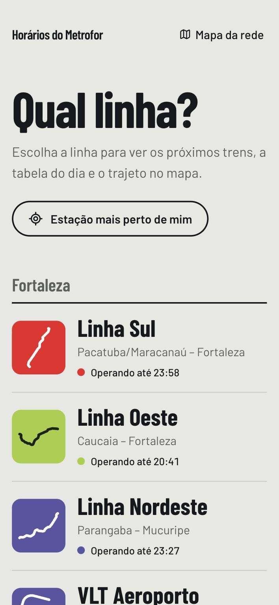
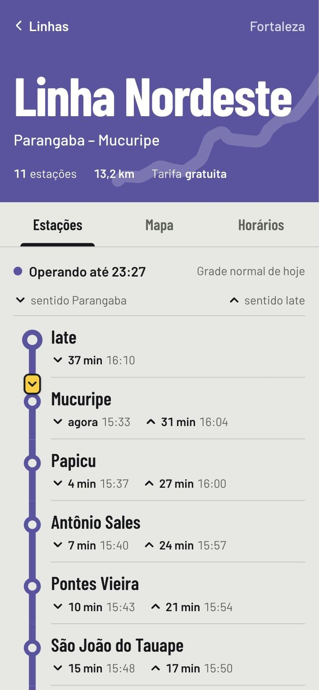
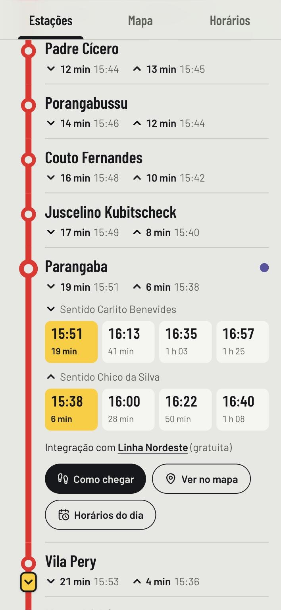
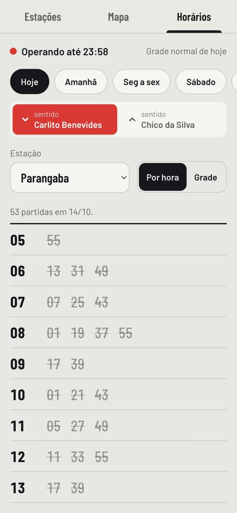
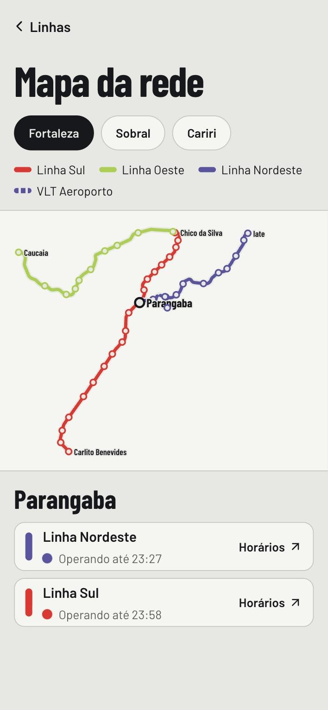

<div align="center">


# Horários do Metrofor

**Próximo trem, tabela do dia e trajeto no mapa para as linhas do Metrofor.**<br />
Fortaleza, Sobral e Cariri, pensado para abrir no celular, na plataforma.

<br />







</div>

---

O [site oficial](https://info.metrofor.ce.gov.br/) tem os horários, mas a tabela completa só sai em PDF e não dá para ver as linhas no mapa. Este projeto usa os mesmos dados e organiza tudo em volta da pergunta que importa quando você está na estação: **quando passa o próximo trem?**

## O que dá para fazer

- **Escolher a linha** e ver na hora se ela está operando ("Operando até 23:58", "Volta amanhã às 05:30").
- **Ver a linha desenhada de cima a baixo**, com o próximo trem em cada sentido em todas as estações.
- **Acompanhar os trens na linha**: os marcadores amarelos mostram onde cada viagem deve estar agora, calculado pela tabela. Não é rastreamento ao vivo, e o app avisa isso.
- **Abrir uma estação** para ver os próximos 4 trens de cada sentido, as integrações e um atalho "Como chegar" que abre o Google Maps a pé até lá.
- **Consultar a tabela do dia** por estação e sentido, agrupada por hora, com as partidas que já passaram riscadas e a próxima destacada. Também tem a grade completa, com estações na lateral e viagens na horizontal.
- **Trocar o dia**: hoje, amanhã, dias úteis, sábado, domingo e datas com horário especial (eleições, feriados).
- **Achar a estação mais perto** pela localização do celular.
- **Ver a rede inteira no mapa**, por cidade, com as integrações entre linhas.
- Tema claro e escuro automático, de acordo com o sistema.

## Linhas

| Cidade    | Linha          | Trajeto                            |
| --------- | -------------- | ---------------------------------- |
| Fortaleza | Linha Sul      | Chico da Silva – Carlito Benevides |
| Fortaleza | Linha Oeste    | Moura Brasil – Caucaia             |
| Fortaleza | Linha Nordeste | Iate – Parangaba                   |
| Fortaleza | VLT Aeroporto  | Expedicionários – Aeroporto        |
| Sobral    | Linha Norte    | Novo Recanto – Cohab III           |
| Sobral    | Linha Sul      | Cohab II – Sumaré                  |
| Cariri    | VLT Cariri     | Crato – Fátima                     |

## De onde vêm os dados

**Horários.** O script [`scripts/scrape_schedules.py`](scripts/scrape_schedules.py) faz o mesmo caminho de quem usa o site oficial: escolhe a linha e pede a "Tabela de Horários" em PDF para cada um dos próximos 21 dias. Depois lê a grade do PDF pela posição de cada horário na página. Cada tabela diferente é guardada uma vez só. Cada dia da semana aponta para a tabela que ele costuma ter, e as datas fora do padrão (como o domingo de eleição) ficam registradas como exceções.

**Traçado e estações.** O script [`scripts/build_geometry.py`](scripts/build_geometry.py) busca no [OpenStreetMap](https://www.openstreetmap.org/) a rota de cada linha, junta os trechos de trilho num único traçado e associa as paradas às estações oficiais.

**Cores.** As mesmas dos ícones das linhas no site do Metrofor.

Os dois scripts geram arquivos JSON em [`src/data/`](src/data), que o site lê no build. Não existe chamada ao Metrofor em tempo real: as páginas são estáticas e o cálculo de "próximo trem" acontece no navegador, no fuso de Fortaleza.

## Rodando localmente

Precisa de [Bun](https://bun.sh). Para atualizar os dados, também de [uv](https://docs.astral.sh/uv/).

```bash
bun install
bun run dev
```

O site abre em http://localhost:3000.

### Atualizar os horários

A grade baixada cobre três semanas a partir do dia em que o script rodou, então vale atualizar antes de publicar:

```bash
bun run data:schedules
```

Se o traçado de alguma linha mudar no OpenStreetMap:

```bash
bun run data:geometry
```

### Google Maps (opcional)

Sem configuração nenhuma, o mapa é desenhado a partir do traçado do OpenStreetMap. Para usar o Google Maps por baixo, crie uma chave com a **Maps JavaScript API** ativada e coloque no `.env.local`:

```bash
NEXT_PUBLIC_GOOGLE_MAPS_API_KEY=sua-chave
# opcional: Map ID vetorial para modo escuro e marcadores personalizados
NEXT_PUBLIC_GOOGLE_MAPS_MAP_ID=seu-map-id
```

Se o Google recusar a chave (domínio não autorizado, cota, chave errada), o site volta sozinho para o mapa desenhado.

## Stack

[Next.js 16](https://nextjs.org) (App Router, páginas estáticas) · React 19 · TypeScript · [Tailwind CSS 4](https://tailwindcss.com) · [@vis.gl/react-google-maps](https://visgl.github.io/react-google-maps/) · [lucide](https://lucide.dev) · Python com [pdfplumber](https://github.com/jsvine/pdfplumber) para ler os PDFs.

```
scripts/            coleta de horários (PDF oficial) e traçado (OpenStreetMap)
src/data/           JSON gerado pelos scripts
src/lib/            regras de horário, fuso, distância e cálculo dos trens
src/components/     diagrama da linha, tabela, mapas
src/app/            páginas: início, /linha/[slug] e /mapa
```

## Aviso

Este projeto não é do Metrofor nem do Governo do Ceará. Os horários são os publicados no site oficial e podem mudar sem aviso. Em caso de dúvida, confira em [info.metrofor.ce.gov.br](https://info.metrofor.ce.gov.br/).

Traçado e estações © colaboradores do [OpenStreetMap](https://www.openstreetmap.org/copyright), sob a licença ODbL.
